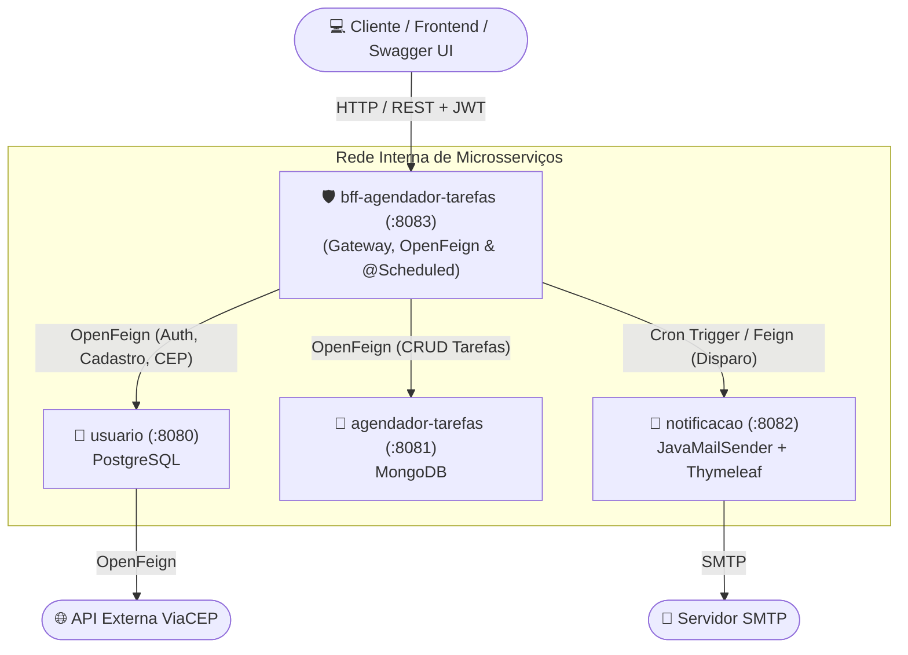
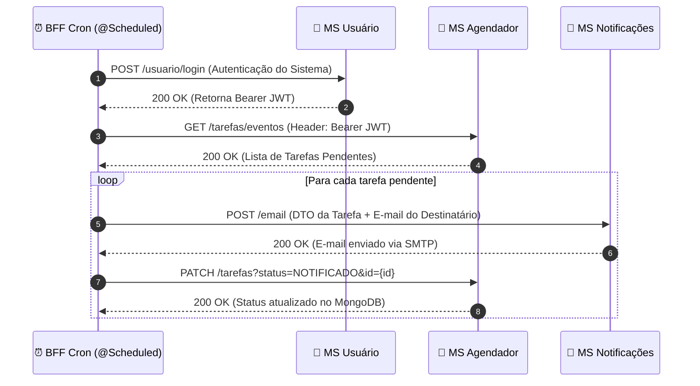

<div align="center">

# 🛡️ BFF Agendador de Tarefas
### API Gateway & Backend For Frontend (BFF) — Distributed Task Scheduler

[](https://openjdk.org/)
[](https://spring.io/projects/spring-boot)
[](https://spring.io/projects/spring-cloud-openfeign)
[](https://swagger.io/)
[](https://www.docker.com/)

<p align="center">
  <b>Ponto de entrada único (API Gateway/BFF) responsável por centralizar a documentação OpenAPI/Swagger, orquestrar a comunicação síncrona entre microsserviços via Spring Cloud OpenFeign e gerenciar rotinas automatizadas com Cron Jobs (@Scheduled).</b>
</p>

</div>

---

## 🌐 Ecossistema do Projeto (Navegação Polyrepo)

> Este microsserviço faz parte de uma arquitetura distribuída composta por **4 serviços autônomos**. Navegue pelos módulos:

| Microsserviço | Papel Arquitetural | Stack & Persistência | Porta | Repositório |
| :--- | :--- | :--- | :---: | :---: |
| 🛡️ **BFF Agendador** | Gateway, Orquestração OpenFeign, Swagger & Cron | Spring Boot 3, OpenFeign, Swagger | `8083` | 📍 **Você está aqui** |
| 👤 **MS Usuário** | Gestão de Identidade, JWT, JPA e API ViaCEP | Spring Security, JWT, PostgreSQL | `8080` | [🔗 `usuario`](https://github.com/matheusrrtavares/usuario) |
| 📅 **MS Agendador** | Core de Agendamentos, Status e Persistência NoSQL | Spring Data MongoDB, MapStruct | `8081` | [🔗 `agendador-tarefas`](https://github.com/matheusrrtavares/agendador-tarefas) |
| 📧 **MS Notificações** | Envio de E-mails Transacionais com HTML Dinâmico | JavaMailSender, Thymeleaf, SMTP | `8082` | [🔗 `notificacao`](https://github.com/matheusrrtavares/notificacao) |

---

## 📐 Arquitetura & Topologia



---

## ⚙️ Responsabilidades Técnicas

1. **Padrão Backend For Frontend (BFF):** Centraliza os contratos e simplifica o consumo por clientes web/mobile, evitando que o frontend conheça a topologia interna dos microsserviços.
2. **Orquestração Síncrona com OpenFeign:** Clientes declarativos (`@FeignClient`) para comunicação HTTP com repasse transparente do token `Bearer JWT`.
3. **Agendamento e Cron Jobs (`@Scheduled`):** Rotina configurável em background que busca tarefas prestes a vencer no `MS Agendador`, aciona o disparo no `MS Notificações` e atualiza o status para `NOTIFICADO`.
4. **Documentação Unificada (OpenAPI/Swagger):** Rota `/swagger-ui/index.html` expondo todos os endpoints orquestrados para testes interativos.

---

## 🔄 Fluxo do Cron Job (Disparo Automatizado)



---

## 📡 Endpoints Centralizados no BFF (Porta 8083)

| Método | Endpoint | Descrição | Requer JWT? | Destino Interno |
| :---: | :--- | :--- | :---: | :--- |
| `POST` | `/usuario` | Cadastra novo usuário com endereço e telefone | ❌ Não | `usuario (:8080)` |
| `POST` | `/usuario/login` | Realiza autenticação e retorna o Bearer Token | ❌ Não | `usuario (:8080)` |
| `GET` | `/usuario/endereco/{cep}` | Consulta dados de endereço na API externa ViaCEP | ❌ Não | `usuario (:8080)` |
| `GET` | `/usuario` | Busca perfil completo do usuário autenticado | ✅ Sim | `usuario (:8080)` |
| `PUT` | `/usuario` | Atualiza dados cadastrais | ✅ Sim | `usuario (:8080)` |
| `DELETE`| `/usuario` | Exclui a conta do usuário logado | ✅ Sim | `usuario (:8080)` |
| `POST` | `/usuario/endereco` | Cadastra novo endereço para o usuário logado | ✅ Sim | `usuario (:8080)` |
| `POST` | `/usuario/telefone` | Cadastra novo telefone para o usuário logado | ✅ Sim | `usuario (:8080)` |
| `POST` | `/tarefas` | Cria um novo agendamento de tarefa | ✅ Sim | `agendador-tarefas (:8081)` |
| `GET` | `/tarefas/eventos` | Lista todas as tarefas do usuário autenticado | ✅ Sim | `agendador-tarefas (:8081)` |
| `PUT` | `/tarefas` | Atualiza informações de uma tarefa existente | ✅ Sim | `agendador-tarefas (:8081)` |
| `PATCH`| `/tarefas` | Atualiza o status (`PENDENTE`, `NOTIFICADO`, `CANCELADO`)| ✅ Sim | `agendador-tarefas (:8081)` |
| `DELETE`| `/tarefas` | Exclui uma tarefa por ID | ✅ Sim | `agendador-tarefas (:8081)` |

---

## 🚀 Como Executar

### Pré-requisitos
* Java JDK 17 ou 21
* Maven 3.8+ (ou `./mvnw`)
* Microsserviços `usuario` (8080), `agendador-tarefas` (8081) e `notificacao` (8082) em execução

### Execução Local
```bash
# Clonar o repositório
git clone https://github.com/matheusrrtavares/bff-agendador-tarefas.git
cd bff-agendador-tarefas

# Compilar e executar
./mvnw clean spring-boot:run
```

### Documentação Interativa
* **Swagger UI:** `http://localhost:8083/swagger-ui/index.html`
* **OpenAPI Docs:** `http://localhost:8083/v3/api-docs`

---

## 👨‍💻 Autor

Desenvolvido por **Matheus Rodrigues Rocha Tavares**  
*Backend Java Developer | Software Engineering B.S.*  
[LinkedIn](https://www.linkedin.com/in/matheusrrtavares) • [GitHub](https://github.com/matheusrrtavares)
